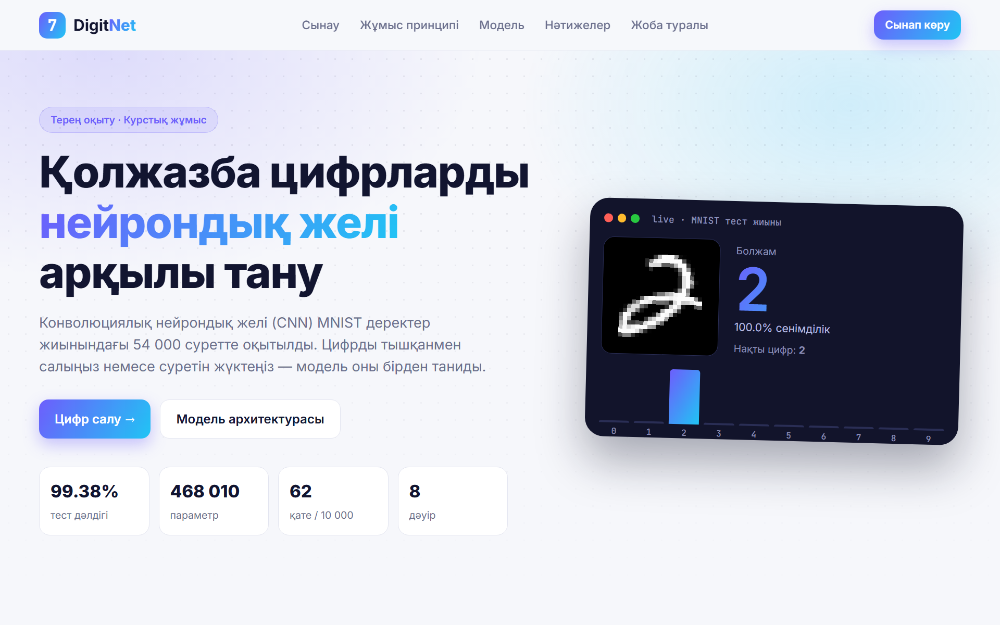
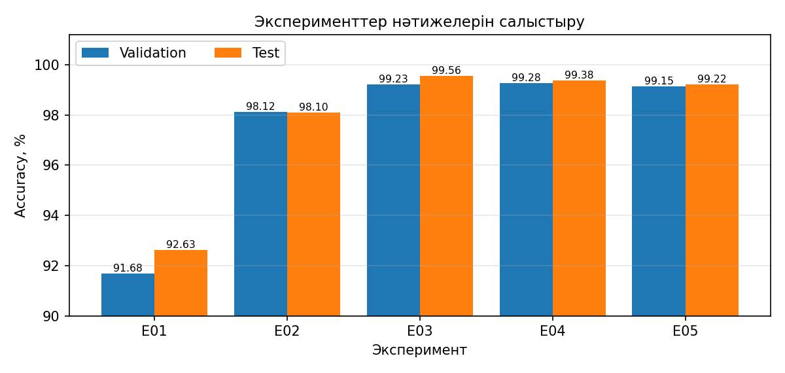
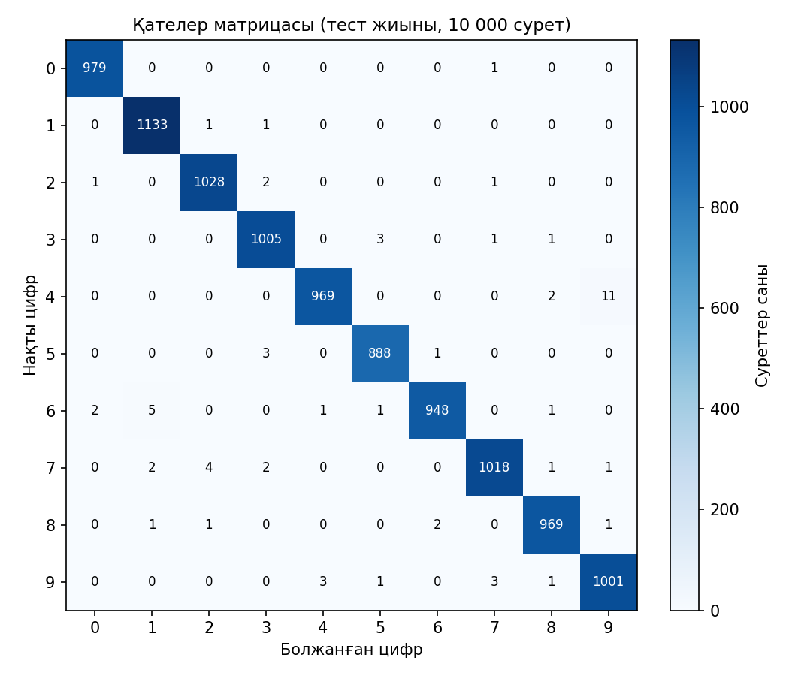

# DigitNet — Handwritten Digit Recognition with a CNN

A compact convolutional neural network trained from scratch on MNIST reaches **99.38 % test accuracy** on a laptop CPU. It is compared under identical conditions with a baseline, an MLP and its own variants, and served through a Flask web app where you draw a digit and see the prediction live.



> Deep Learning (TO 4304) coursework — L.N. Gumilyov Eurasian National University, 2026.

## Features

- **Five reproducible experiments.** Every run has a JSON config, a fixed seed (42), a fixed split and an automatic experiment log (`outputs/experiments.csv`).
- **Honest model selection.** The best model is chosen on the validation split only, and the test split is used once for the final evaluation.
- **Full evaluation.** Accuracy, macro Precision / Recall / F1, ROC-AUC, a confusion matrix, per-class metrics and misclassified examples.
- **Exploratory data analysis.** Class balance, duplicates, train/test overlap and pixel statistics.
- **Preprocessing for real input.** Any user image (white paper, phone photo, canvas drawing) is converted into MNIST format: inversion, cropping, 20×20 fit and centre-of-mass centring.
- **Web app (Flask + vanilla JS).** Draw-to-predict canvas with real-time probabilities, image upload, MNIST samples and a REST API. The layout is responsive.
- **Unit tests** for the models, the data split and the preprocessing.

## Results

| ID | Model | Note | Val acc, % | Test acc, % |
|---|---|---|---|---|
| E01 | Logistic regression (baseline) | scikit-learn, raw pixels | 91.68 | 92.63 |
| E02 | MLP 784-256-128-10 | no augmentation | 98.12 | 98.10 |
| E03 | DigitCNN | no augmentation | 99.23 | 99.56 |
| **E04** | **DigitCNN + augmentation (selected)** | RandomAffine, lr 1e-3 | **99.28** | **99.38** |
| E05 | DigitCNN + augmentation | lr 3e-4 | 99.15 | 99.22 |

The final model is E04, picked by validation accuracy. It reaches test accuracy 99.38 %, macro-F1 99.38 % and ROC-AUC 0.99998, with 62 errors out of 10 000. Training took 19.8 min on a CPU.
The CNN variants differ by ≤ 0.13 pp on validation (about 8 of 6 000 images), so the gap between them is within run-to-run noise. The real gain comes from the convolutional architecture itself (MLP → CNN).

<p float="left">
  
  
</p>

## Tech stack

Python 3.12 · PyTorch / torchvision · scikit-learn · NumPy · Matplotlib · Pillow · Flask · HTML / CSS / JavaScript (Canvas API)

## Project structure

```
configs/        experiment configs E01–E05 (JSON)
data/           how the data is obtained (MNIST downloads automatically)
src/            data.py · model.py · train.py · evaluate.py · predict.py
tests/          unit tests (unittest)
outputs/        experiments.csv · metrics.json · figures/ · per-experiment history
models/         digit_cnn.pt — the selected model (≈1.9 MB)
web/, app.py    Flask server + single-page frontend
scripts/        run_all.sh · make_figures.py · make_report.py (coursework .docx) · make_slides.js
```

## How to run

```bash
pip install -r requirements.txt

# web app with the pre-trained model (no training needed)
python app.py                                   # http://localhost:5000

# reproduce the experiments
python -m src.train --config configs/E04_cnn_aug.json
bash scripts/run_all.sh                         # E01–E05 + final evaluation
python -m src.evaluate --select-best

# tests
python -m unittest discover tests
```

API: `POST /api/predict` (image → digit, confidence, 10 probabilities) · `GET /api/sample` · `GET /api/metrics`.

## Data

MNIST, by Y. LeCun, C. Cortes and C. J. C. Burges, licensed CC BY-SA 3.0. The dataset is **not** stored in this repository; `torchvision` downloads it on first run. There are no personal data in this project.

## Қысқаша (KZ)

Бұл – «Терең оқыту» пәні бойынша курстық жұмыс. MNIST жиынында нөлден оқытылған ықшам CNN тест жиынында 99,38% дәлдік көрсетті. Модель базалық логистикалық регрессиямен, MLP-мен және өзінің нұсқаларымен бірдей шартта салыстырылды (5 эксперимент, seed 42). Таңдау тек validation бойынша жасалды. Flask веб-қосымшасында цифрды тышқанмен салып, нәтижені нақты уақытта көруге болады.

**Author:** Dias Ayazbai · Generative AI (Claude) was used as an assistant for code structure, UI and drafting, and all experiments were run and checked locally.
